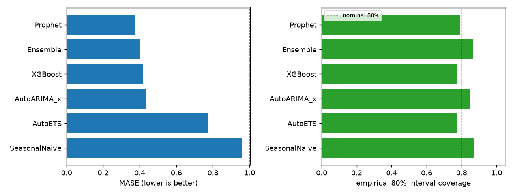
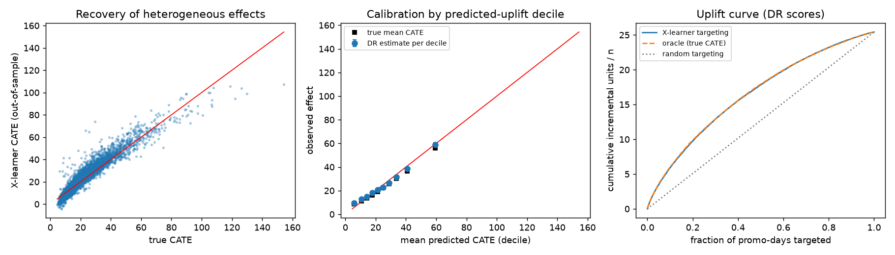

# Demand Forecasting & Causal Uplift Engine

[](https://github.com/rkesseku/demand-forecasting-uplift/actions/workflows/ci.yml)

A hybrid forecasting platform that combines classical time-series methods with gradient-boosted models, plus causal-inference techniques that estimate the *true incremental lift* of promotions and operational interventions: moving beyond correlation to decision-grade impact estimates.

## The problem

Retail and operations teams ask two different questions that are usually answered with the same dashboard:

1. **How much will we sell?** A forecasting problem, judged by out-of-sample accuracy and honest uncertainty.
2. **What did the promotion actually cause?** A causal problem. Promotions are not randomly assigned: they are scheduled when demand is already expected to be high, and more often in some stores. Comparing promo days to non-promo days therefore credits the promotion with demand that would have happened anyway.

This project treats both properly, and, because the demo data is synthetic with a **known ground-truth effect**, it can *check* that the causal estimators recover the truth and that the naive comparison does not.

## Architecture

```
src/demand_uplift/
  data.py       generate(): confounded multi-store x multi-product daily demand + ground truth
  features.py   leakage-safe lag / rolling / calendar features (every lag >= horizon)
  forecast.py   SeasonalNaive, AutoETS, AutoARIMA (+exog), Prophet, XGBoost (+CQR intervals),
                Ensemble; rolling-origin backtest; MASE, sMAPE, interval coverage
  causal.py     naive, regression adjustment, EconML DML / DR / causal forest, own cross-fitted
                AIPW, T-/X-learner CATE, calibration + uplift curve, DoWhy graph/identify/refute
  report.py     Markdown report + matplotlib figures
  cli.py        python -m demand_uplift {generate,backtest,causal,report}
tests/          pytest suite (fast; ~40 s on a quiet laptop)
```

**Libraries used.** Forecasting: [statsforecast](https://github.com/Nixtla/statsforecast) (SeasonalNaive, AutoETS, AutoARIMA with exogenous regressors), [Prophet](https://facebook.github.io/prophet/), [XGBoost](https://xgboost.readthedocs.io/). Causal: [DoWhy](https://github.com/py-why/dowhy) (explicit causal graph, backdoor identification, estimation, refutation tests) and [EconML](https://github.com/py-why/EconML) (`LinearDML`, `CausalForestDML`, `LinearDRLearner`, `TLearner`, `XLearner`). Hand-written code is kept only where it adds value: the naive baseline, a small cross-fitted AIPW estimator (used as an independent cross-check and to produce the doubly-robust scores behind the uplift and calibration diagnostics), and the backtest/metrics/report plumbing.

## Methods

### Synthetic data with known ground truth

For series *s* (store x product) and day *t*:

```
log mu0[s,t] = level[s] + trend[s]*t + weekly[dow] + yearly[s](doy) + holiday[t] + elasticity[s]*log(price[s,t]/base[s])
promo[s,t]  ~ Bernoulli( sigmoid(a + b*z[s,t] + store_bias) ),   z = standardised log mu0     <- confounded
tau[s,t]     = mu0[s,t] * lift[store, product] * (1.3 on weekends)                            <- heterogeneous
units[s,t]   = mu0[s,t] + promo[s,t]*tau[s,t] + noise
```

Promotions are more likely when expected demand is high and in some stores, so the naive contrast is biased upward. `true_tau` (the per-row causal effect), `true_baseline` and `true_propensity` are stored in `true_*` columns and never used as model inputs. Output is fully determined by `--seed`.

### Forecasting

* **Baselines and classical:** weekly seasonal naive; AutoETS (m=7); AutoARIMA with promo, log-price, holiday and yearly Fourier regressors (a SARIMAX-style model); Prophet with the same regressors.
* **Global gradient boosting:** one XGBoost model across all series, fit on `log1p(units)`. Features are calendar terms, store/product codes, future-known covariates (planned promo, price, holiday) and target lags/rolling statistics. For forecast horizon *h*, every target-derived feature is shifted by **at least h days**: `lag_h, lag_{h+7}, lag_{h+14}, lag_{h+28}, lag_364`, and rolling mean/std computed on `y` shifted by *h*. A row at date *t* therefore never sees `y` after `t-h`, so one direct prediction per horizon step is leak-free. A test perturbs all future targets and asserts features of rows up to `origin + h` do not change.
* **Intervals:** classical models and Prophet use their native 80% intervals. XGBoost uses 10%/90% quantile models, then **conformalised quantile regression**: with calibration scores `E_i = max(lo_i - y_i, y_i - hi_i)` on a trailing 56-day window, the interval is widened by the `ceil((n+1)(1-alpha))/n` empirical quantile of `E`.
* **Ensemble:** mean of AutoETS, AutoARIMA, Prophet and XGBoost point forecasts and interval bounds.
* **Backtest:** rolling origin (4 origins, 28-day step, 14-day horizon). Metrics: `MASE = MAE / MAE_in-sample seasonal-naive(m=7)`, `sMAPE = 100 * mean(2|y-yhat| / (|y|+|yhat|))`, empirical coverage and mean width of the nominal 80% interval. The per-series models are scored on a fixed set of 6 series; XGBoost is trained globally on all series and scored on the same 6.

### Causal uplift

Estimand: average treatment effect `ATE = E[Y(1) - Y(0)]` in units per promo-day. Under unconfoundedness given pre-treatment covariates *X* (store, product, calendar, price, holiday, trend) and overlap:

* **Naive:** `mean(Y | D=1) - mean(Y | D=0)`; biased by confounding.
* **Regression adjustment:** OLS of `Y` on `D` and `X` with HC3 errors. Misspecified here (the baseline is nonlinear and effects scale with it).
* **Double/debiased ML (partialling-out)**, EconML `LinearDML`: cross-fit `m(X)=E[Y|X]` and `e(X)=P(D=1|X)`, then regress residuals: `theta = sum(D~ * Y~) / sum(D~^2)` with `Y~ = Y - m(X)`, `D~ = D - e(X)`; sandwich standard error. With heterogeneity this targets the `Var(D|X)`-weighted average effect, reported separately in the table. `LinearDML-het` lets the effect vary linearly in *X* and averages it, which targets the ATE.
* **AIPW / doubly robust:** cross-fitted `psi = mu1(X) - mu0(X) + D(Y - mu1)/e - (1-D)(Y - mu0)/(1-e)` (propensity clipped to [0.02, 0.98]); `ATE = mean(psi)`, CI from the influence function `std(psi)/sqrt(n)`. EconML's `LinearDRLearner` is run alongside.
* **CATE:** T-learner (`mu1 - mu0`), X-learner (imputed effects blended by the propensity), `CausalForestDML`. CATEs are predicted **out of sample** (2-fold cross-fitting) and compared with the known `true_tau` (correlation, RMSE).
* **Calibration and uplift curve:** predicted-CATE deciles vs. the mean doubly-robust score (and the true mean effect) per decile; a best-linear-predictor slope of DR scores on predicted CATE (1 = calibrated); an uplift curve of cumulative incremental units when targeting the top-q fraction by predicted CATE, against random targeting and an oracle that sorts by `true_tau`.
* **DoWhy:** an explicit causal graph (store, product, dow, yearly Fourier terms, holiday, log price, trend -> promo and -> demand; promo -> demand), backdoor identification, estimation through the identified estimand (propensity-score stratification and DML via DoWhy's EconML bridge), and three refuters (placebo treatment, random common cause, data subset).

## Quick start

```bash
git clone https://github.com/rkesseku/demand-forecasting-uplift.git
cd demand-forecasting-uplift
python -m venv .venv && source .venv/bin/activate      # Windows: .venv\Scripts\activate
pip install -e ".[dev]"

# write synthetic data
python -m demand_uplift generate --seed 42 --out output

# forecast backtest only / causal analysis only / everything + report + figures
python -m demand_uplift backtest --seed 42 --out output
python -m demand_uplift causal   --seed 42 --out output
python -m demand_uplift report   --seed 42 --out output     # ~3-5 min on a laptop

pytest -q
ruff check src tests
```

`report` writes `report.md`, `results.json` and PNG figures into `--out`. Useful flags: `--stores/--products/--days`, `--models SeasonalNaive,AutoETS,AutoARIMA_x,Prophet,XGBoost`, `--origins`, `--series`, `--folds`, `--iters`, `--trees`, `--no-dowhy`. A console script `demand-uplift` is installed too.

## Results

All numbers below were produced by `python -m demand_uplift report --seed 42` on **synthetic data** (seed 42): 8 stores x 5 products x 1,095 days = 43,800 rows, 21.1% promo-days. The generated report is saved verbatim in [`docs/sample_report.md`](docs/sample_report.md).

### Forecast backtest (4 rolling origins, 14-day horizon, 6 series, nominal 80% intervals)

| model | MASE | sMAPE (%) | 80% coverage | mean width |
|---|---|---|---|---|
| Prophet | 0.377 | 9.493 | 0.789 | 23.689 |
| Ensemble | 0.404 | 9.902 | 0.866 | 34.419 |
| XGBoost | 0.419 | 10.460 | 0.774 | 33.574 |
| AutoARIMA_x | 0.437 | 11.061 | 0.845 | 32.174 |
| AutoETS | 0.774 | 19.393 | 0.771 | 48.240 |
| SeasonalNaive | 0.956 | 23.550 | 0.872 | 82.786 |

Models that see the promo and price regressors (Prophet, AutoARIMA, XGBoost) cut MASE by more than half relative to the seasonal-naive baseline (0.956) and by roughly 45% relative to AutoETS, which cannot use them. Prophet is the most accurate model on this setup; the ensemble over-covers slightly because averaging interval bounds widens them. With only 4 origins x 6 series (336 held-out points per model), the coverage figures are noisy and the ranking between the top three models is not statistically conclusive.



### Causal uplift (true ATE = 23.989 incremental units per promo day)

The ground-truth ATT is 31.607 and the `Var(D|X)`-weighted estimand targeted by constant-effect DML is 28.585.

| method | estimate | se | 95% CI | bias | CI covers ATE |
|---|---|---|---|---|---|
| naive | 56.829 | 0.690 | [55.478, 58.181] | +32.840 | no |
| regression adjustment | 34.692 | 0.380 | [33.947, 35.437] | +10.703 | no |
| LinearDML (constant effect) | 29.889 | 0.217 | [29.465, 30.314] | +5.900 | no |
| LinearDML-het | 24.951 | 0.168 | [24.622, 25.281] | +0.962 | no |
| DRLearner | 25.954 | 0.184 | [25.594, 26.314] | +1.965 | no |
| CausalForestDML | 28.091 | 2.237 | [23.708, 32.475] | +4.102 | yes |
| AIPW (own, cross-fitted) | 25.424 | 0.171 | [25.088, 25.759] | +1.434 | no |


Reading this honestly:

* The naive contrast overstates the effect by about 137%. Every adjusted method moves the estimate most of the way to the truth. The heterogeneity-aware, doubly-robust estimators (`LinearDML-het`, AIPW, `DRLearner`) land within 4% to 8% of the true ATE.
* Constant-effect `LinearDML` estimates 29.9, close to the `Var(D|X)`-weighted effect 28.6 it actually targets, not the ATE: with heterogeneous effects, "the DML coefficient" is a weighted average, not the ATE.
* **The nominal 95% CIs for the parametric estimators do not cover the true ATE.** The remaining bias (about 1 to 2 units) comes from imperfect gradient-boosting nuisance models (the propensity model in particular) in a finite sample. The sandwich and influence-function standard errors only capture sampling noise, not that nuisance error. Only the causal forest, whose interval is much wider, covers. Treat the CIs as lower bounds on uncertainty.
* Standard errors also assume independent rows; real promo data has serial correlation and would need clustered errors.

### Heterogeneous effects (out-of-sample CATE)

| learner | corr with true CATE | RMSE | calibration slope (se) | uplift gain vs random (x ATE) |
|---|---|---|---|---|
| T-learner | 0.898 | 8.421 | 0.827 (0.015) | 0.140 |
| X-learner | 0.949 | 5.252 | 0.934 (0.014) | 0.147 |
| CausalForestDML | 0.806 | 10.353 | 1.236 (0.023) | 0.130 |

The X-learner recovers the true CATE best (correlation 0.949). In the decile calibration table the doubly-robust estimate per predicted-uplift decile tracks the true mean effect (decile 1: DR 9.4 vs true 8.7; decile 10: DR 59.1 vs true 55.8), with a small upward offset consistent with the ATE bias above. Targeting by X-learner score nearly matches the oracle uplift curve.



### DoWhy refutation (6,000-row subsample)

The graph has 10 nodes; all eight observed covariates are common causes of promo and demand. The backdoor estimand gives 35.480 with propensity-score stratification (a logistic propensity model that cannot capture the nonlinear confounding; included as an illustration of DoWhy's default estimators, not as a competitive estimate) and 31.351 via DoWhy's EconML `LinearDML` bridge on the same subsample.

| refuter | new effect | p-value |
|---|---|---|
| placebo treatment (permuted promo) | 0.087 | 0.466 |
| random common cause | 35.480 | 0.159 |
| data subset (80%) | 35.104 | 0.310 |

The placebo effect is near zero and no refuter rejects, so the estimate is stable under these perturbations. Refuters cannot detect unobserved confounding, which is ruled out here only because the generator is known.

## Limitations

* Synthetic data only. The point is a verifiable ground truth, not realism. Real data would add censoring (stock-outs), cannibalisation and promo-run structure (consecutive promo days), and unobserved confounders.
* Identification relies on unconfoundedness given the observed covariates, which holds by construction here.
* The backtest uses a small number of origins and series for speed; increase `--origins` and `--series` for tighter estimates.

## License

MIT, see [LICENSE](LICENSE).
