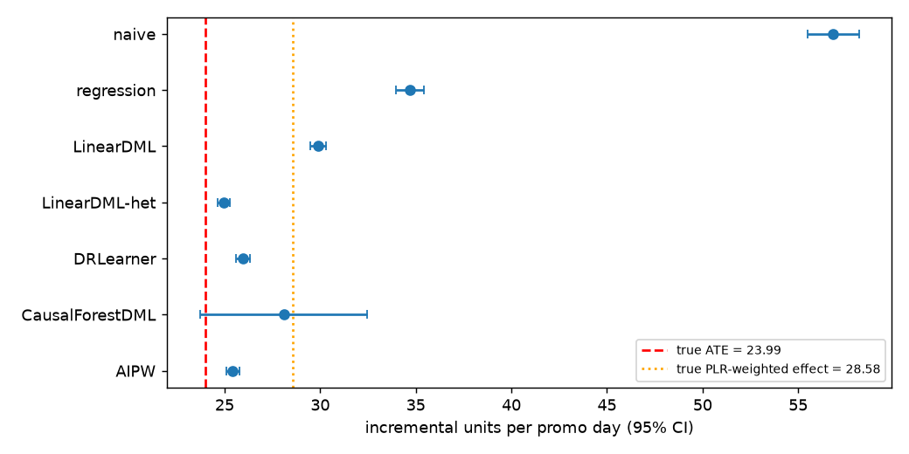
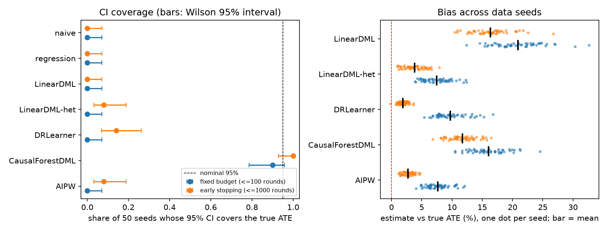

# Demand Forecasting & Causal Uplift Engine

[](https://github.com/rkesseku/demand-forecasting-uplift/actions/workflows/ci.yml)

A hybrid forecasting platform that combines classical time-series methods with gradient-boosted models. It also uses causal-inference techniques to estimate the *true incremental lift* of promotions and operational interventions, so that impact estimates go beyond correlation and can support decisions.

## The problem

Retail and operations teams ask two different questions that are usually answered with the same dashboard:

1. **How much will we sell?** A forecasting problem, judged by out-of-sample accuracy and honest uncertainty.
2. **What did the promotion actually cause?** A causal problem. Promotions are not randomly assigned. They are scheduled when demand is already expected to be high, and more often in some stores. Comparing promo days to non-promo days therefore credits the promotion with demand that would have happened anyway.

This project addresses both. Because the demo data is synthetic, with a **known ground-truth effect**, the project can *check* that the causal estimators recover the truth and that the naive comparison does not.

## Architecture

```
src/demand_uplift/
  data.py       generate(): confounded multi-store x multi-product daily demand + ground truth
  features.py   leakage-safe lag / rolling / calendar features (every lag >= horizon)
  forecast.py   SeasonalNaive, AutoETS, AutoARIMA (+exog), Prophet, XGBoost (+CQR intervals),
                Ensemble; rolling-origin backtest; MASE, sMAPE, interval coverage
  causal.py     naive, regression adjustment, EconML DML / DR / causal forest, own cross-fitted
                AIPW, T-/X-learner CATE, calibration + uplift curve, DoWhy graph/identify/refute,
                multi-seed coverage study of the ATE estimators
  report.py     Markdown report + matplotlib figures
  cli.py        python -m demand_uplift {generate,backtest,causal,coverage,report}
tests/          pytest suite (CPU only, tiny synthetic panels)
docs/results/   multi-seed coverage study (JSON, CSV, figure) and XGBoost early-stopping comparison (JSON)
```

**Libraries used.** Forecasting: [statsforecast](https://github.com/Nixtla/statsforecast) (SeasonalNaive, AutoETS, AutoARIMA with exogenous regressors), [Prophet](https://facebook.github.io/prophet/), [XGBoost](https://xgboost.readthedocs.io/). Causal: [DoWhy](https://github.com/py-why/dowhy) (explicit causal graph, backdoor identification, estimation, refutation tests) and [EconML](https://github.com/py-why/EconML) (`LinearDML`, `CausalForestDML`, `LinearDRLearner`, `TLearner`, `XLearner`). Hand-written code is kept only where it adds value: the naive baseline, a small cross-fitted AIPW estimator (used as an independent cross-check and to produce the doubly-robust scores behind the uplift and calibration diagnostics), and the backtest/metrics/report plumbing.

## Methods

### Synthetic data with known ground truth

For series *s* (store x product) and day *t*:

```
log mu0[s,t] = level[s] + trend[s]*t + weekly[dow] + yearly[s](doy) + holiday[t] + elasticity[s]*log(price[s,t]/base[s])
promo[s,t]  ~ Bernoulli( sigmoid(a + b*z[s,t] + store_bias) ),   z = standardised log mu0     <- confounded
tau[s,t]     = mu0[s,t] * lift[store, product] * (1.3 on weekends)                            <- heterogeneous
units[s,t]   = mu0[s,t] + promo[s,t]*tau[s,t] + noise
```

Promotions are more likely when expected demand is high and in some stores, so the naive contrast is biased upward. `true_tau` (the per-row causal effect), `true_baseline` and `true_propensity` are stored in `true_*` columns and never used as model inputs. Output is fully determined by `--seed`.

### Forecasting

* **Baselines and classical models:** weekly seasonal naive and AutoETS (m=7). AutoARIMA uses promo, log-price, holiday and yearly Fourier regressors (a SARIMAX-style model), and Prophet uses the same regressors.
* **Global gradient boosting:** one XGBoost model across all series, fit on `log1p(units)`. Features are calendar terms, store/product codes, future-known covariates (planned promo, price, holiday) and target lags/rolling statistics. For forecast horizon *h*, every target-derived feature is shifted by **at least h days**: `lag_h, lag_{h+7}, lag_{h+14}, lag_{h+28}, lag_364`, and rolling mean/std computed on `y` shifted by *h*. A row at date *t* therefore never sees `y` after `t-h`, so one direct prediction per horizon step is leak-free. A test perturbs all future targets and asserts that features of rows up to `origin + h` do not change.
* **XGBoost tree count:** chosen by early stopping inside each rolling origin. The model is first trained on data up to 28 days before its training cut-off, with early stopping (patience 50, at most 2,000 trees) on those last 28 days, then refit on all training rows with the selected count. Only data dated before the forecast origin is used (a test scrambles every target after the origin and checks that the forecast is unchanged). `--no-xgb-es` restores the original fixed 300 trees.
* **Intervals:** classical models and Prophet use their native 80% intervals. XGBoost uses 10%/90% quantile models, then **conformalised quantile regression**: with calibration scores `E_i = max(lo_i - y_i, y_i - hi_i)` on a trailing 56-day window, the interval is widened by the `ceil((n+1)(1-alpha))/n` empirical quantile of `E`.
* **Ensemble:** mean of AutoETS, AutoARIMA, Prophet and XGBoost point forecasts and interval bounds.
* **Backtest:** rolling origin (4 origins, 28-day step, 14-day horizon). Metrics: `MASE = MAE / MAE_in-sample seasonal-naive(m=7)`, `sMAPE = 100 * mean(2|y-yhat| / (|y|+|yhat|))`, empirical coverage and mean width of the nominal 80% interval. The per-series models are scored on a fixed set of 6 series. XGBoost is trained globally on all series and scored on the same 6.

### Causal uplift

Estimand: average treatment effect `ATE = E[Y(1) - Y(0)]` in units per promo-day. Under unconfoundedness given pre-treatment covariates *X* (store, product, calendar, price, holiday, trend) and overlap:

* **Naive:** `mean(Y | D=1) - mean(Y | D=0)`. Confounding biases it.
* **Regression adjustment:** OLS of `Y` on `D` and `X` with HC3 errors. Misspecified here (the baseline is nonlinear and effects scale with it).
* **Double/debiased ML (partialling-out)**, EconML `LinearDML`. Cross-fit `m(X)=E[Y|X]` and `e(X)=P(D=1|X)`, then regress residuals as `theta = sum(D~ * Y~) / sum(D~^2)` with `Y~ = Y - m(X)`, `D~ = D - e(X)`, using a sandwich standard error. With heterogeneous effects, this targets the `Var(D|X)`-weighted average effect, reported separately in the table. `LinearDML-het` lets the effect vary linearly in *X* and averages it, which targets the ATE.
* **AIPW / doubly robust:** cross-fitted `psi = mu1(X) - mu0(X) + D(Y - mu1)/e - (1-D)(Y - mu0)/(1-e)` (propensity clipped to [0.02, 0.98]). Then `ATE = mean(psi)`, with a CI from the influence function `std(psi)/sqrt(n)`. EconML's `LinearDRLearner` is run alongside.
* **CATE:** T-learner (`mu1 - mu0`), X-learner (imputed effects blended by the propensity), `CausalForestDML`. CATEs are predicted **out of sample** (2-fold cross-fitting) and compared with the known `true_tau` (correlation, RMSE).
* **Calibration and uplift curve:** predicted-CATE deciles are compared with the mean doubly-robust score (and the true mean effect) in each decile. A best-linear-predictor slope of DR scores on predicted CATE measures calibration (1 = calibrated). The uplift curve shows cumulative incremental units when targeting the top-q fraction by predicted CATE, against random targeting and an oracle that sorts by `true_tau`.
* **Nuisance models:** scikit-learn histogram gradient boosting (learning rate 0.1, 15 leaves). `--nuisance fixed` (default, used for the seed-42 tables) caps each model at `--iters 100` rounds. With `--nuisance es` the cap rises to 1,000 rounds and each model early-stops on a 10% validation split of each training fold. Both settings were chosen by held-out nuisance loss, never by closeness to the true ATE.
* **Coverage study:** `coverage` re-generates the synthetic panel for many data seeds, runs every ATE estimator on each, and reports mean bias, RMSE, empirical 95% CI coverage of each seed's true ATE with a Wilson interval on that coverage, and mean CI width.
* **DoWhy:** an explicit causal graph (store, product, dow, yearly Fourier terms, holiday, log price, trend -> promo and -> demand, plus promo -> demand), backdoor identification, estimation through the identified estimand (propensity-score stratification and DML via DoWhy's EconML bridge), and three refuters (placebo treatment, random common cause, data subset).

## Quick start

```bash
git clone https://github.com/rkesseku/demand-forecasting-uplift.git
cd demand-forecasting-uplift
python -m venv .venv && source .venv/bin/activate      # Windows: .venv\Scripts\activate
pip install -e ".[dev]"

# write synthetic data
python -m demand_uplift generate --seed 42 --out output

# forecast backtest only / causal analysis only / everything + report + figures
python -m demand_uplift backtest --seed 42 --out output
python -m demand_uplift causal   --seed 42 --out output
python -m demand_uplift report   --seed 42 --out output     # ~3-5 min on a quiet laptop

# ATE bias / coverage over 50 data seeds, fixed vs early-stopped nuisances (hours; see below)
python -m demand_uplift coverage --seed 42 --n-seeds 50 --modes fixed,es --out output

pytest -q
ruff check src tests
```

`report` writes `report.md`, `results.json` and PNG figures into `--out`. Useful flags: `--stores/--products/--days`, `--models SeasonalNaive,AutoETS,AutoARIMA_x,Prophet,XGBoost`, `--origins`, `--series`, `--no-xgb-es`, `--folds`, `--iters`, `--trees`, `--nuisance {fixed,es}`, `--no-dowhy`. `coverage` also takes `--n-seeds`, `--modes`, `--jobs`, `--resume` (skip seeds already in `coverage_raw.csv`) and `--from-raw` (only summarise finished runs). A console script `demand-uplift` is installed too.

## Results

All numbers below were produced by `python -m demand_uplift report --seed 42` on **synthetic data** (seed 42): 8 stores x 5 products x 1,095 days = 43,800 rows, 21.1% promo-days. The generated report is saved verbatim in [`docs/sample_report.md`](docs/sample_report.md).

### Forecast backtest (4 rolling origins, 14-day horizon, 6 series, nominal 80% intervals)

| model | MASE | sMAPE (%) | 80% coverage | mean width |
|---|---|---|---|---|
| Prophet | 0.377 | 9.493 | 0.783 | 23.612 |
| Ensemble | 0.409 | 10.026 | 0.875 | 32.812 |
| XGBoost | 0.428 | 10.765 | 0.768 | 27.196 |
| AutoARIMA_x | 0.438 | 11.067 | 0.842 | 32.199 |
| AutoETS | 0.774 | 19.393 | 0.771 | 48.240 |
| SeasonalNaive | 0.956 | 23.550 | 0.872 | 82.786 |

Models that see the promo and price regressors (Prophet, AutoARIMA, XGBoost) cut MASE by more than half relative to the seasonal-naive baseline (0.956) and by roughly 45% relative to AutoETS, which cannot use them. Prophet is the most accurate model in this setup. The ensemble over-covers slightly because averaging interval bounds widens them. With only 4 origins x 6 series (336 held-out points per model), the coverage figures are noisy and the ranking among the top three models is not statistically conclusive. Prophet's interval coverage also moves between reruns (0.774 to 0.789 in four runs here) because its uncertainty sampling is not seeded.

**XGBoost early stopping** ([`docs/results/xgb_early_stopping.json`](docs/results/xgb_early_stopping.json)). Early stopping picked 485 to 712 trees for the point model (and 630 to 1,111 for the quantile models), more than the old fixed 300, but accuracy barely moved:

| XGBoost run (seed 42) | MASE | sMAPE (%) | 80% coverage | mean width |
|---|---|---|---|---|
| fixed 300 trees, 2 threads | 0.429 | 10.711 | 0.780 | 33.534 |
| early stopping, 2 threads | 0.428 | 10.765 | 0.768 | 27.196 |
| fixed 300 trees, 1 thread | 0.427 | 10.626 | 0.774 | 33.672 |
| early stopping, 1 thread | 0.420 | 10.517 | 0.777 | 26.706 |

MASE improves by 0.002 (2 threads) and 0.007 (1 thread). Changing only the thread count moves it by the same 0.002 to 0.007, though, because XGBoost's histogram sums depend on the thread count. sMAPE also moves in opposite directions in the two pairs. Early stopping therefore does not measurably improve point accuracy here, although its intervals are about 20% narrower at similar coverage. The previous README value (MASE 0.419) came from an earlier run with the previous `n_jobs=4` setting and does not reproduce at 2 threads. The main table is the current 2-thread run with early stopping.


### Causal uplift (true ATE = 23.989 incremental units per promo day)

The ground-truth ATT is 31.607 and the `Var(D|X)`-weighted estimand targeted by constant-effect DML is 28.585.

| method | estimate | se | 95% CI | bias | CI covers ATE |
|---|---|---|---|---|---|
| naive | 56.829 | 0.690 | [55.478, 58.181] | +32.840 | no |
| regression adjustment | 34.692 | 0.380 | [33.947, 35.437] | +10.703 | no |
| LinearDML (constant effect) | 29.889 | 0.217 | [29.465, 30.314] | +5.900 | no |
| LinearDML-het | 24.951 | 0.168 | [24.622, 25.281] | +0.962 | no |
| DRLearner | 25.954 | 0.184 | [25.594, 26.314] | +1.965 | no |
| CausalForestDML | 28.091 | 2.237 | [23.708, 32.475] | +4.102 | yes |
| AIPW (own, cross-fitted) | 25.424 | 0.171 | [25.088, 25.759] | +1.434 | no |



Reading this honestly:

* The naive contrast overstates the effect by about 137%. Every adjusted method moves the estimate most of the way to the truth. The heterogeneity-aware, doubly-robust estimators (`LinearDML-het`, AIPW, `DRLearner`) land within 4% to 8% of the true ATE (across 50 data seeds their mean bias is 7.5% to 9.7% with the default nuisances and 1.9% to 3.8% with early-stopped ones, as shown below).
* Constant-effect `LinearDML` estimates 29.9. That is close to the `Var(D|X)`-weighted effect of 28.6, which is what it actually targets. With heterogeneous effects, "the DML coefficient" is a weighted average and not the ATE.
* On this one seed, only the causal forest's 95% CI covers the true ATE. A single draw cannot establish coverage, so the next section repeats the whole estimation over 50 data seeds. That study confirms that the intervals of the other estimators under-cover badly.
* Standard errors also assume independent rows. Real promo data has serial correlation and would need clustered errors.
* Early-stopped nuisances (`--nuisance es`) are clearly better (next section), but the seed-42 table keeps the default fixed budget so that it stays comparable with earlier versions of this README. With early stopping, seed 42 gives LinearDML-het 24.28, DRLearner 24.39 and AIPW 24.62 (biases +0.29 to +0.63), but their CIs still miss the truth.

### Coverage across 50 data seeds

`python -m demand_uplift coverage --seed 42 --n-seeds 50 --modes fixed,es` re-generates the panel for data seeds 42 to 91 (same size as above, with the true ATE ranging from 14.4 to 60.9 across seeds) and re-runs every ATE estimator, once with the default nuisance budget and once with early-stopped nuisances. Results: [`docs/results/coverage_study.json`](docs/results/coverage_study.json) (per-seed rows in `coverage_raw.csv`). Coverage is the share of the 50 seeds whose 95% CI contains that seed's true ATE. The brackets are Wilson 95% intervals for that share. Naive and regression use no nuisance models, so they are listed once.

| method | nuisances | mean bias | RMSE | 95% CI coverage [Wilson 95%] | mean CI width |
|---|---|---|---|---|---|
| naive | none | +33.90 | 35.91 | 0.00 [0.00, 0.07] | 3.69 |
| regression adjustment | none | +14.32 | 15.36 | 0.00 [0.00, 0.07] | 1.81 |
| LinearDML (constant effect) | fixed | +5.58 | 5.92 | 0.00 [0.00, 0.07] | 1.08 |
| | early stopping | +4.38 | 4.66 | 0.00 [0.00, 0.07] | 0.97 |
| LinearDML-het | fixed | +2.04 | 2.25 | 0.00 [0.00, 0.07] | 0.82 |
| | early stopping | +1.05 | 1.28 | 0.08 [0.03, 0.19] | 0.72 |
| DRLearner | fixed | +2.59 | 2.78 | 0.00 [0.00, 0.07] | 0.89 |
| | early stopping | +0.50 | 0.55 | 0.14 [0.07, 0.26] | 0.65 |
| CausalForestDML | fixed | +4.27 | 4.51 | 0.90 [0.79, 0.96] | 9.96 |
| | early stopping | +3.14 | 3.34 | 1.00 [0.93, 1.00] | 9.07 |
| AIPW (own, cross-fitted) | fixed | +2.03 | 2.17 | 0.00 [0.00, 0.07] | 0.87 |
| | early stopping | +0.73 | 0.79 | 0.08 [0.03, 0.19] | 0.78 |



What this supports:

* **The under-coverage is not a seed-42 accident.** With the default budget, none of the 50 intervals of LinearDML, LinearDML-het, DRLearner or AIPW contains the true ATE (coverage 0%, Wilson upper bound 7%). Their bias is positive in every one of the 50 seeds and averages 9 to 12 times the reported standard error (20 times for constant-effect LinearDML). Constant-effect LinearDML also misses the `Var(D|X)`-weighted effect it targets (coverage 2%).
* **The nuisance budget explains a large part of the bias. Fixing it helps a lot, but not enough.** The default outcome model stops at its 100-round cap (with early stopping it runs to 444 rounds on seed 42). Letting the nuisances early-stop cuts the mean bias of the doubly robust estimators by 64% to 81% (DRLearner +2.59 to +0.50, AIPW +2.03 to +0.73) and their RMSE by a similar share. Coverage only rises to 8% to 14%, far below 95%. The remaining bias is still 3 to 4 standard errors and positive in 49 or 50 of the 50 seeds, and the spread of the errors across seeds is 1.4 to 1.6 times the reported standard error.
* **The causal forest's coverage is not a sign of accuracy.** It covers in 90% (fixed) and 100% (early stopping) of seeds, yet it is the most biased ML estimator after constant-effect DML (+3.1 to +4.3, 12% to 16% of the ATE). It covers only because its interval is 11 to 14 times wider than the others, and its standard error is 1.7 to 2 times the actual spread of its errors.
* So the nominal intervals of the efficient estimators should not be read as 95% intervals on data like this. Treat them as lower bounds on uncertainty. The truth here is each seed's in-sample average effect, for which influence-function standard errors are, if anything, conservative, so the choice of target is not what drives the under-coverage.

Runtime, with one process per nuisance setting and one thread each (`--jobs 1`) on a shared machine, was about 150 s per seed with the fixed budget (2.1 h for 50 seeds) and 283 s per seed with early stopping (3.9 h of compute, run as two halves in parallel and merged with `--from-raw`).

### Heterogeneous effects (out-of-sample CATE)

| learner | corr with true CATE | RMSE | calibration slope (se) | uplift gain vs random (x ATE) |
|---|---|---|---|---|
| T-learner | 0.898 | 8.421 | 0.827 (0.015) | 0.140 |
| X-learner | 0.949 | 5.252 | 0.934 (0.014) | 0.147 |
| CausalForestDML | 0.806 | 10.353 | 1.236 (0.023) | 0.130 |

The X-learner recovers the true CATE best (correlation 0.949). In the decile calibration table, the doubly-robust estimate per predicted-uplift decile tracks the true mean effect (DR 9.4 vs true 8.7 in decile 1, DR 59.1 vs true 55.8 in decile 10), with a small upward offset consistent with the ATE bias above. Targeting by X-learner score nearly matches the oracle uplift curve.


### DoWhy refutation (6,000-row subsample)

The graph has 10 nodes, and all eight observed covariates are common causes of promo and demand. The backdoor estimand gives 35.480 with propensity-score stratification and 31.137 via DoWhy's EconML `LinearDML` bridge on the same subsample. The stratification uses a logistic propensity model that cannot capture the nonlinear confounding. It is there to illustrate DoWhy's default estimators and is not meant as a competitive estimate. The bridge is not seeded, so its value varies slightly between runs (an earlier run gave 31.351).

| refuter | new effect | p-value |
|---|---|---|
| placebo treatment (permuted promo) | 0.087 | 0.466 |
| random common cause | 35.480 | 0.159 |
| data subset (80%) | 35.104 | 0.310 |

The placebo effect is near zero and no refuter rejects, so the estimate is stable under these perturbations. Refuters cannot detect unobserved confounding, which is ruled out here only because the generator is known.

## Limitations

* Synthetic data only. The point is a verifiable ground truth rather than realism. Real data would add censoring (stock-outs), cannibalisation and promo-run structure (consecutive promo days), and unobserved confounders.
* Identification relies on unconfoundedness given the observed covariates, which holds by construction here.
* The backtest uses a small number of origins and series for speed. Increase `--origins` and `--series` for tighter estimates.
* The coverage study varies the data seed only. Nuisance settings other than the round count (learning rate, leaves) were not tuned, and no bias-corrected or bootstrap interval was tried, so whether any interval method reaches 95% here is still open.

## License

MIT, see [LICENSE](LICENSE).
