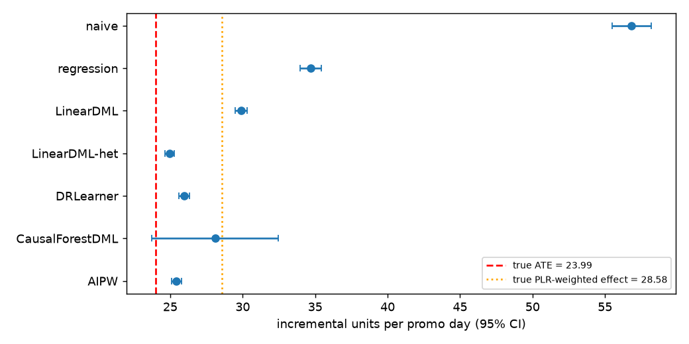
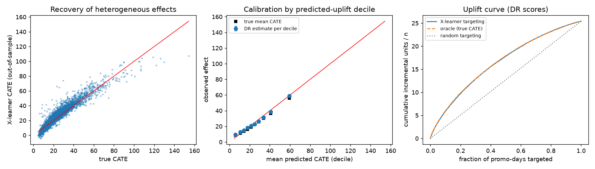

```{=typst}
#set text(hyphenate: false)
#show heading.where(level: 1): it => block(above: 1.2em, below: 0.6em)[
  #set text(fill: rgb("#1f4e9e"), size: 14pt, weight: "bold")
  #it
]
#show heading.where(level: 2): set text(fill: rgb("#2d2d2d"), size: 11.5pt)
#let glance(body) = block(fill: rgb("#eef3fb"), stroke: (left: 3pt + rgb("#1f4e9e")), inset: 10pt, radius: 2pt, width: 100%, body)
```

```{=typst}
#glance[
*At a glance* \
*Problem:* Retail teams need to know how much they will sell and what a promotion truly added, but promotions are scheduled when demand is already high, so simple promo versus non-promo comparisons overstate their impact. \
*What I built:* A Python package that (1) forecasts daily demand with Prophet, AutoARIMA, AutoETS and XGBoost under rolling-origin backtesting, and (2) estimates causal promotion lift with EconML (DML, doubly robust, causal forest) and DoWhy refutation, all on synthetic data where the true effect is known. \
*Headline result (seed 42):* The naive comparison says a promotion adds 56.8 units per day; the true figure is 24.0 (a 137% overstatement). Adjusted estimators land within 4% to 8% of the truth, and Prophet is the most accurate forecaster (MASE 0.377 versus 0.956 for the seasonal-naive baseline). \
*Stack:* Python, statsforecast, Prophet, XGBoost, EconML, DoWhy, scikit-learn, pytest, ruff \
*Repo:* #link("https://github.com/rkesseku/demand-forecasting-uplift")[github.com/rkesseku/demand-forecasting-uplift]
]
```

# The problem

Retail and operations teams ask two different questions that are usually answered with the same dashboard.

1. **How much will we sell?** This is a forecasting problem. It is judged on out-of-sample accuracy and on whether the stated uncertainty can be trusted.
2. **What did the promotion cause?** This is a causal problem, and it is the harder one. Promotions are not handed out at random. They tend to run when demand is already expected to be high, and more often in some stores. If you compare promo days with non-promo days, the promotion gets credit for sales that would have happened anyway.

The picture below shows the idea. Expected demand pushes up both the chance that a promotion runs and the number of units sold. The arrow we care about, from promotion to units, is tangled up with that shared cause.

{#fig-conf width=78%}

Real data never reveals the true effect, so nobody can say whether an uplift method is right. This project removes that obstacle by generating **synthetic data with a known ground-truth effect**. That makes it possible to check, rather than assume, that each estimator recovers the truth and that the naive one does not.

# Approach

## Architecture

The package has one generator and two tracks that share it: a forecasting track and a causal track.

{#fig-arch width=80%}

The source is about 1,270 lines across six modules (`data.py`, `features.py`, `forecast.py`, `causal.py`, `report.py`, `cli.py`) plus a pytest suite of 22 tests. Running `python -m demand_uplift report --seed 42` reproduces the whole analysis from one seed.

## The synthetic data

Each series is a store and product pair, observed daily. Demand without promotion combines a store level, trend, weekday and yearly seasonality, holidays and price elasticity. A promotion is switched on with a probability that rises with that expected demand, so it is confounded by design. The extra units caused by a promotion vary by store and product and are 1.3 times larger on weekends, so the effect is heterogeneous. The true effect is stored in `true_*` columns and never given to a model. The seed-42 data set has 8 stores, 5 products and 1,095 days (43,800 rows) with 21.1% promo days.

# Methods and design decisions

## Forecasting

Five models plus an ensemble are compared: a weekly seasonal naive baseline, AutoETS, AutoARIMA with promo, price, holiday and yearly Fourier regressors, Prophet with the same regressors, and one global XGBoost model trained across all series.

* **Leakage-safe features.** Gradient boosting is only honest if the features cannot peek at the future. For a forecast horizon of *h* days, every feature built from past sales is shifted by at least *h* days. A test perturbs all future sales and checks that features up to the forecast origin do not change.
* **Rolling-origin backtest.** Four forecast origins, 28 days apart, with a 14-day horizon.
* **Scale-free metrics.** MASE divides the error by that of an in-sample seasonal-naive forecast, so 1.0 means "no better than last week's pattern" and lower is better.
* **Uncertainty.** The classical models and Prophet use their native 80% intervals. XGBoost gets conformalised quantile regression: the quantile band is widened by an amount calibrated on a trailing 56-day window.

## Causal uplift

The target is the average treatment effect (ATE): extra units sold per promo day. Assuming that, once store, product, calendar, price, holiday and trend are accounted for, promotion is as good as random (true by construction here), the estimators run from simple to modern:

* **Naive difference and regression adjustment.** The first ignores confounding; the second adjusts linearly, which is the wrong shape for this nonlinear data.
* **Double machine learning (DML).** Flexible models predict both sales and the chance of promotion from the covariates; the effect is then estimated from what is left over in each. Constant-effect and varying-effect versions are both run.
* **Doubly robust estimators.** EconML's DR learner and a small hand-written cross-fitted AIPW estimator. They stay consistent if either the outcome model or the promotion model is good.
* **Heterogeneous effects (CATE).** T-learner, X-learner and a causal forest estimate a different effect for each row. They are evaluated out of sample against the known true effects, with a calibration table and an uplift curve showing the incremental units gained by targeting only the top-scoring promo days.
* **DoWhy refutation.** An explicit causal graph, backdoor identification, estimation and three stress tests (placebo treatment, random common cause, data subset).

# Results


## Forecast accuracy

| Model | MASE | sMAPE (%) | 80% coverage | Mean width |
|---|---|---|---|---|
| Prophet | 0.377 | 9.49 | 0.789 | 23.7 |
| Ensemble | 0.404 | 9.90 | 0.866 | 34.4 |
| XGBoost | 0.419 | 10.46 | 0.774 | 33.6 |
| AutoARIMA (with regressors) | 0.437 | 11.06 | 0.845 | 32.2 |
| AutoETS | 0.774 | 19.39 | 0.771 | 48.2 |
| SeasonalNaive | 0.956 | 23.55 | 0.872 | 82.8 |

: Seed-42 synthetic data (full report in docs/sample_report.md). Backtest: 4 rolling origins, 14-day horizon, 6 series, nominal 80% intervals. {#tbl-bt}

The three models that see the promo and price regressors (Prophet, AutoARIMA, XGBoost) cut error by more than half relative to the seasonal-naive baseline, and by about 45% relative to AutoETS, which cannot use them. With four origins and six series (336 held-out points per model) the ranking among the top three is not statistically conclusive.


## Causal estimates

The true ATE is 23.989 units per promo day; the weighted average that constant-effect DML targets is 28.585.

As Table 2 and Figure 3 show, the naive contrast overstates the effect by about 137%. The heterogeneity-aware, doubly robust estimators (LinearDML-het, AIPW, DRLearner) land within 4% to 8% of the truth. Constant-effect LinearDML sits near 28.6, the weighted average it targets, a reminder that "the DML coefficient" is not the ATE when effects vary.

**An honest note on the confidence intervals.** Six of the seven 95% intervals miss the true value, including those of the best estimators. This is not an arithmetic bug. Those intervals only account for random sampling noise. The remaining error of one to two units comes from the flexible models that predict sales and promotion being imperfect in a finite sample, and the interval formulas do not include that error. Only the causal forest, whose interval is much wider, covers the truth. In practice the intervals should be read as a lower bound on uncertainty. Rows are also treated as independent, whereas real promo data has serial correlation and would need clustered errors.

| Method | Estimate | 95% CI | Bias | CI covers true ATE |
|---|---|---|---|---|
| Naive | 56.83 | [55.48, 58.18] | +32.84 | no |
| Regression adjustment | 34.69 | [33.95, 35.44] | +10.70 | no |
| LinearDML (constant effect) | 29.89 | [29.47, 30.31] | +5.90 | no |
| LinearDML-het | 24.95 | [24.62, 25.28] | +0.96 | no |
| DRLearner | 25.95 | [25.59, 26.31] | +1.97 | no |
| CausalForestDML | 28.09 | [23.71, 32.48] | +4.10 | yes |
| AIPW (own, cross-fitted) | 25.42 | [25.09, 25.76] | +1.43 | no |

: Causal estimates against the known truth of 23.989. {#tbl-causal}

{#fig-causal width=62%}

## Who benefits most

The X-learner recovers the row-level effect best (correlation 0.949 with the truth, calibration slope 0.934), ahead of the T-learner (0.898) and the causal forest (0.806, slope 1.236). In the decile table the estimated effect tracks the true one (lowest decile: 9.4 estimated versus 8.7 true; highest: 59.1 versus 55.8), with a small upward offset consistent with the ATE bias. Targeting promo days by X-learner score nearly matches an oracle that knows the true effect.

{#fig-cate width=82%}

## DoWhy refutation

On a 6,000-row subsample the placebo refuter (permuted promotion) gives an effect of 0.087 (p = 0.466), and neither the random-common-cause refuter (p = 0.159) nor the 80% data-subset refuter (p = 0.310) rejects. Refuters cannot detect unobserved confounding; here it is ruled out only because the generator is known. DoWhy's default propensity-stratification estimate (35.48) uses a logistic propensity model and is shown as an illustration, not as a competitive estimator.

# What this demonstrates

* **Causal reasoning, not just prediction.** Recognising confounding, stating the estimand and its identifying assumption, and choosing estimators accordingly, including the weighted-versus-average-effect subtlety.
* **Verifiability by design.** A generator with a known truth turns causal claims into testable ones. Forecasts are validated the same way, through leakage tests and a rolling-origin backtest.
* **Honest reporting.** Intervals that fail to cover are reported and explained, small-sample caveats are stated, and rankings that are not significant are not presented as wins.
* **Engineering hygiene.** A single-seed reproducible pipeline, a command-line interface, 22 tests (data, features, forecasting, causal, CLI), lint with ruff and a CI workflow.

# Limitations and next steps

**Limitations.**

* The data are synthetic, and unconfoundedness holds by construction (with real data it would have to be argued). The point is a verifiable truth, not realism. Real data add stock-outs (censored demand), cannibalisation between products, consecutive promo days and unobserved confounders, none of which are modelled.
* The backtest uses 4 origins and 6 series for speed, so coverage figures are noisy and the top-three forecast ranking is not conclusive.
* Parametric confidence intervals under-cover because they ignore nuisance-model error; standard errors assume independent rows.
* All reported results come from a single seed (42); variation across seeds is not reported.

**Next steps.** Repeat the study over many seeds to report bias and coverage as distributions; add clustered standard errors and a bootstrap that includes the nuisance models; add censoring, cannibalisation and a hidden confounder to the generator to test sensitivity analysis; widen the backtest (more origins and series); and try the pipeline on a public retail data set.

# How to run it

```{=typst}
#block(fill: rgb("#f5f5f5"), inset: 8pt, radius: 2pt, width: 100%)[
#set text(font: "DejaVu Sans Mono", size: 8.5pt)
git clone https://github.com/rkesseku/demand-forecasting-uplift.git \
cd demand-forecasting-uplift \
python -m venv .venv    \# then activate it \
pip install -e ".[dev]" \
python -m demand_uplift report --seed 42 --out output    \# about 3 to 5 minutes \
pytest -q
]
```

The `generate`, `backtest` and `causal` subcommands run each stage alone. The report writes `report.md`, `results.json` and the figures into the output folder, and the seed-42 run is saved in `docs/sample_report.md`. This brief's two diagrams are rebuilt by `docs/brief/make_figures.py`; the other three figures are copies of the report's output.
