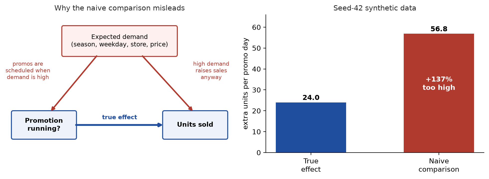
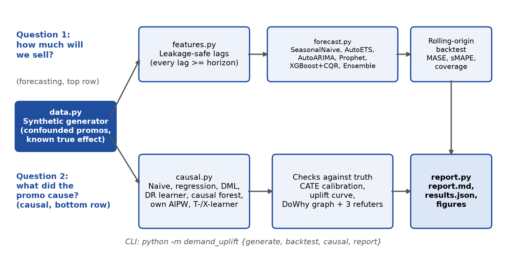

```{=typst}
#show <refs>: set par(hanging-indent: 0.5in, first-line-indent: 0pt, justify: false)
#set text(hyphenate: false)
#set bibliography(title: "References")
#show cite: set text(fill: rgb("#1f4e9e"))
#show bibliography: set par(justify: false)
// Three-rule tables (top, below header, bottom) and bold "Figure N" / "Table N" labels
#set table.hline(stroke: 0.6pt)
#show table: it => box(stroke: (top: 1pt, bottom: 1pt), it)
#show figure.caption: it => context [#strong[#it.supplement~#it.counter.display(it.numbering)#it.separator]#it.body]
#show table: set par(justify: false)
#show heading.where(level: 1): it => block(above: 1.2em, below: 0.6em)[
  #set text(fill: rgb("#1f4e9e"), size: 14pt, weight: "bold")
  #it
]
#show heading.where(level: 2): set text(fill: rgb("#2d2d2d"), size: 11.5pt)
#let glance(body) = block(fill: rgb("#eef3fb"), stroke: (left: 3pt + rgb("#1f4e9e")), inset: 10pt, radius: 2pt, width: 100%, body)
// Header: red title, subtitle, author, repository link
#align(center)[
  #set par(justify: false)
  #text(size: 17pt, weight: "bold", fill: rgb("#b91c1c"))[Demand Forecasting and Causal Promotion Uplift]
  #v(0.5em)
  #text(size: 12pt, weight: "bold")[Forecast what will sell, then measure what a promotion actually caused]
  #v(0.9em)
  #text(size: 11pt)[Reagan Kesseku, Ph.D.]
  #linebreak()
  #text(size: 10pt)[#link("https://github.com/rkesseku/demand-forecasting-uplift")[github.com/rkesseku/demand-forecasting-uplift]]
  #v(0.45em)
  #text(size: 9.5pt)[#emph[Keywords:] demand forecasting, causal inference, double machine learning, uplift modelling, promotion effects]
]
#v(0.5em)
```

```{=typst}
#glance[
*At a glance* \
*Problem:* Retail teams need to know how much they will sell and what a promotion truly added, but promotions are scheduled when demand is already high, so simple promo versus non-promo comparisons overstate their impact. \
*What I built:* A Python package that (1) forecasts daily demand with Prophet, AutoARIMA, AutoETS and XGBoost under rolling-origin backtesting, and (2) estimates causal promotion lift with EconML (DML, doubly robust, causal forest) and DoWhy refutation. Everything runs on synthetic data where the true effect is known. \
*Headline result (seed 42):* The naive comparison says a promotion adds 56.8 units per day. The true figure is 24.0, so the naive number overstates it by 137%. Adjusted estimators land within 4% to 8% of the truth, but a 50-seed study shows their 95% intervals almost never contain it. Prophet is the most accurate forecaster (MASE 0.377 versus 0.956 for the seasonal-naive baseline). \
*Stack:* Python, statsforecast, Prophet, XGBoost, EconML, DoWhy, scikit-learn, pytest, ruff \
*Repo:* #link("https://github.com/rkesseku/demand-forecasting-uplift")[github.com/rkesseku/demand-forecasting-uplift]
]
```

# The problem

Retail and operations teams ask two different questions that are usually answered with the same dashboard.

1. **How much will we sell?** This is a forecasting problem. It is judged on out-of-sample accuracy and on whether the stated uncertainty can be trusted.
2. **What did the promotion cause?** This is a causal problem, and it is the harder one. Promotions are not handed out at random. They tend to run when demand is already expected to be high, and more often in some stores. If you compare promo days with non-promo days, the promotion gets credit for sales that would have happened anyway.

The figure below shows the idea. Expected demand raises both the chance that a promotion runs and the number of units sold. The arrow we care about, from promotion to units, is entangled with that shared cause.

{#fig-conf width=78%}

Real data never reveal the true effect, so no one can tell whether an uplift method is right. I got around this by generating **synthetic data with a known ground-truth effect**. With the truth in hand, I can check whether each estimator recovers it and whether the naive comparison fails.

# Approach

## Architecture

The package has one generator and two tracks that share it: a forecasting track and a causal track.

{#fig-arch width=80%}

The source is about 1,560 lines across six modules (`data.py`, `features.py`, `forecast.py`, `causal.py`, `report.py`, `cli.py`) plus a pytest suite of 28 tests. Running `python -m demand_uplift report --seed 42` reproduces the whole analysis from one seed.

## The synthetic data

Each series is a store and product pair, observed daily. Demand without promotion combines a store level, trend, weekday and yearly seasonality, holidays and price elasticity. A promotion is switched on with a probability that rises with this baseline demand, so it is confounded by design. The extra units a promotion causes vary by store and product and are 1.3 times larger on weekends, so the effect is heterogeneous. The true effect is stored in `true_*` columns and never given to a model. The seed-42 data set has 8 stores, 5 products and 1,095 days (43,800 rows) with 21.1% promo days.

# Methods and design decisions

## Forecasting

I compare five models and an ensemble: a weekly seasonal-naive baseline, AutoETS, AutoARIMA [@hyndman2008] with promo, price, holiday and yearly Fourier regressors, Prophet [@taylor2018] with the same regressors, and one global XGBoost [@chen2016xgboost] model trained across all series.

* **Leakage-safe features.** Gradient boosting is only honest if the features cannot peek at the future. For a forecast horizon of *h* days, every feature built from past sales is shifted by at least *h* days. A test perturbs all future sales and checks that features up to the forecast origin do not change.
* **Rolling-origin backtest.** Four forecast origins, 28 days apart, with a 14-day horizon.
* **Scale-free metrics.** MASE divides the error by that of an in-sample seasonal-naive forecast, so 1.0 means "no better than last week's pattern" and lower is better.
* **Uncertainty.** The classical models and Prophet use their native 80% intervals. XGBoost gets conformalised quantile regression, which widens the quantile band by an amount calibrated on a trailing 56-day window.
* **No hand-picked tree count.** Inside each origin, XGBoost's number of trees is chosen by early stopping on the 28 days just before its training cut-off, and the model is then refit on all training data. Nothing after the forecast origin is used.

## Causal uplift

The target is the average treatment effect (ATE), the extra units sold per promo day. I assume that promotion assignment is as good as random once store, product, calendar, price, holiday and trend are accounted for. Here that holds by construction. The estimators range from simple to modern.

* **Naive difference and regression adjustment.** The first ignores confounding. The second adjusts linearly, although the data are nonlinear.
* **Double machine learning (DML).** Following @chernozhukov2018, flexible models predict both sales and the chance of promotion from the covariates. The effect is then estimated from the residuals of each. I run both constant-effect and varying-effect versions.
* **Doubly robust estimators.** EconML's DR learner [@econml] and a small hand-written cross-fitted AIPW estimator [@robins1994]. They stay consistent if either the outcome model or the promotion model is correct.
* **Heterogeneous effects (CATE).** T-learner, X-learner [@kunzel2019] and a causal forest [@wager2018] estimate a different effect for each row. I evaluate them out of sample against the known true effects, with a calibration table and an uplift curve showing the incremental units gained by targeting only the top-scoring promo days.
* **Coverage study.** The estimation is repeated on 50 freshly generated data sets, with the flexible models capped at 100 boosting rounds (default) or early-stopped on held-out data (never tuned on the true effect).
* **DoWhy refutation** [@sharma2020dowhy]**.** An explicit causal graph, backdoor identification, estimation and three stress tests (placebo treatment, random common cause, data subset).

# Results


## Forecast accuracy

| Model | MASE | sMAPE (%) | 80% coverage | Mean width |
|-----------------------------------------|---------|---------------|-------------------|----------------|
| Prophet | **0.377** | **9.49** | **0.783** | **23.6** |
| Ensemble | 0.409 | 10.03 | 0.875 | 32.8 |
| XGBoost | 0.428 | 10.76 | 0.768 | 27.2 |
| AutoARIMA (with regressors) | 0.438 | 11.07 | 0.842 | 32.2 |
| AutoETS | 0.774 | 19.39 | 0.771 | 48.2 |
| SeasonalNaive | 0.956 | 23.55 | 0.872 | 82.8 |

: Seed-42 synthetic data (full report in docs/sample_report.md). Backtest: 4 rolling origins, 14-day horizon, 6 series, nominal 80% intervals. Bold marks the best value in each column: lowest error, coverage closest to 0.80 and narrowest interval. {#tbl-bt}

The three models that see the promo and price regressors (Prophet, AutoARIMA, XGBoost) cut error by more than half relative to the seasonal-naive baseline, and by about 45% relative to AutoETS, which cannot use them. With four origins and six series (336 held-out points per model), the ranking among the top three is not statistically conclusive. Early stopping chose 485 to 712 XGBoost trees instead of a fixed 300. MASE moved only from 0.429 to 0.428, within the noise from changing the CPU thread count, while the intervals narrowed by about 20%.


## Causal estimates

The true ATE is 23.989 units per promo day. The weighted average that constant-effect DML targets is 28.585.

As Table 2 shows, the naive contrast overstates the effect by about 137%. The heterogeneity-aware, doubly robust estimators (LinearDML-het, AIPW, DRLearner) land within 4% to 8% of the truth. Constant-effect LinearDML sits near 28.6, the weighted average it targets. When effects vary, "the DML coefficient" is not the ATE.

**An honest note on the confidence intervals.** Six of the seven 95% intervals in Table 2 miss the true value. One data set cannot show whether that is bad luck, so I repeated the estimation on 50 freshly generated data sets (Table 3, Figure 3). With the default models, LinearDML, LinearDML-het, DRLearner and AIPW never covered the truth in 50 tries, and they overestimated it every time. Training the sales and promotion models longer, with early stopping on held-out data, cut the bias of the doubly robust estimators by 64% to 81% (DRLearner from +2.6 to +0.5 units). Their coverage still only rose to 8% to 14%, because the remaining bias is three to four standard errors. The causal forest covers 90% to 100% of the time only because its interval is more than ten times wider, and it is more biased than the doubly robust estimators. The other intervals should be read as lower bounds on uncertainty.

| Method | Estimate | 95% CI | Bias | CI covers true ATE |
|-----------------------------------------|-------------|----------------------|----------|-------------|
| Naive | 56.83 | [55.48, 58.18] | +32.84 | no |
| Regression adjustment | 34.69 | [33.95, 35.44] | +10.70 | no |
| LinearDML (constant effect) | 29.89 | [29.47, 30.31] | +5.90 | no |
| LinearDML-het | **24.95** | [24.62, 25.28] | **+0.96** | no |
| DRLearner | 25.95 | [25.59, 26.31] | +1.97 | no |
| CausalForestDML | 28.09 | [23.71, 32.48] | +4.10 | **yes** |
| AIPW (own, cross-fitted) | 25.42 | [25.09, 25.76] | +1.43 | no |

: Causal estimates on the seed-42 data set against the known truth of 23.989 (default models). Bold marks the estimate closest to the truth and the only interval that covers it. {#tbl-causal}

| Method | Bias, default | Bias, early stop | Coverage, default | Coverage, early stop |
|-----------------------------|---------------|------------------|-------------------|-------------------|
| LinearDML (constant effect) | +5.58 | +4.38 | 0.00 [0.00, 0.07] | 0.00 [0.00, 0.07] |
| LinearDML-het | **+2.04** | +1.05 | 0.00 [0.00, 0.07] | 0.08 [0.03, 0.19] |
| DRLearner | +2.59 | **+0.50** | 0.00 [0.00, 0.07] | 0.14 [0.07, 0.26] |
| CausalForestDML | +4.27 | +3.14 | **0.90 [0.79, 0.96]** | **1.00 [0.93, 1.00]** |
| AIPW (own, cross-fitted) | +2.03 | +0.73 | 0.00 [0.00, 0.07] | 0.08 [0.03, 0.19] |

: Over 50 generated data sets (seeds 42 to 91): mean bias in units per promo day and the share of data sets whose 95% interval contains the true ATE, with a Wilson 95% interval for that share. "Default" means at most 100 boosting rounds, and "early stop" means up to 1,000, stopped on held-out data. Bold: smallest bias and coverage closest to 0.95 in each column. Naive and regression never cover. {#tbl-cov}

{#fig-cov width=68%}

## Who benefits most

The X-learner recovers the row-level effect best (correlation 0.949 with the truth, calibration slope 0.934), ahead of the T-learner (0.898) and the causal forest (0.806, slope 1.236). In the decile table, the estimate tracks the truth (9.4 versus 8.7 in the lowest decile, 59.1 versus 55.8 in the highest), with a small upward offset consistent with the ATE bias. Targeting promo days by X-learner score nearly matches an oracle that knows the true effect.

{#fig-cate width=68%}

## DoWhy refutation

On a 6,000-row subsample, the placebo refuter (permuted promotion) gives an effect of 0.087 (p = 0.466), and neither the random-common-cause refuter (p = 0.159) nor the 80% data-subset refuter (p = 0.310) rejects. Refuters cannot detect unobserved confounding, which is ruled out here only because the generator is known. DoWhy's default stratification estimate (35.48) is an illustration rather than a competitive estimator.

# What this demonstrates

* **Causal reasoning beyond prediction.** Recognising confounding, stating the estimand and its identifying assumption, and choosing estimators to match, including the weighted-versus-average-effect subtlety.
* **Verifiability by design.** A generator with a known truth turns causal claims into testable ones. Forecasts get leakage tests and a rolling-origin backtest.
* **Honest reporting.** Interval coverage is tested over 50 data sets rather than asserted, and rankings that are not significant are not presented as wins.
* **Engineering hygiene.** A seed-reproducible pipeline, a command-line interface, 28 tests (data, features, forecasting, causal, CLI), lint with ruff and a CI workflow.

# Limitations and next steps

**Limitations.**

* The data are synthetic, and unconfoundedness holds by construction. The point is a verifiable truth rather than realism. Real data add stock-outs (censored demand), cannibalisation between products, consecutive promo days and unobserved confounders, none of which are modelled.
* The backtest uses 4 origins and 6 series from one seed, so forecast coverage is noisy and the top-three ranking is not conclusive.
* The intervals of the efficient causal estimators under-cover badly across 50 data sets, even with better-trained nuisance models. The standard errors also assume independent rows, but real promo data are serially correlated.
* Only the ATE estimators were repeated across seeds. The CATE diagnostics are from seed 42.

**Next steps.** Tune the nuisance models further by held-out loss and test whether bootstrap or bias-corrected intervals reach 95% coverage. Add clustered standard errors and give the generator censoring, cannibalisation and a hidden confounder. Widen the backtest and try a public retail data set.

# How to run it

```{=typst}
#block(fill: rgb("#f5f5f5"), inset: 8pt, radius: 2pt, width: 100%)[
#set text(font: "DejaVu Sans Mono", size: 8.5pt)
git clone https://github.com/rkesseku/demand-forecasting-uplift.git \
cd demand-forecasting-uplift \
python -m venv .venv    \# then activate it \
pip install -e ".[dev]" \
python -m demand_uplift report --seed 42 --out output    \# about 3 to 5 minutes \
pytest -q
]
```

The `generate`, `backtest` and `causal` subcommands run each stage alone. The report writes `report.md`, `results.json` and the figures to the output folder, and the seed-42 run is in `docs/sample_report.md`. The `coverage` subcommand reruns the 50-seed study (it takes hours, with results in `docs/results/`). This brief's two diagrams come from `docs/brief/make_figures.py`, the coverage figure from `docs/results/` and the other two from the report output.

# References {.unnumbered}

::: {#refs}
:::
