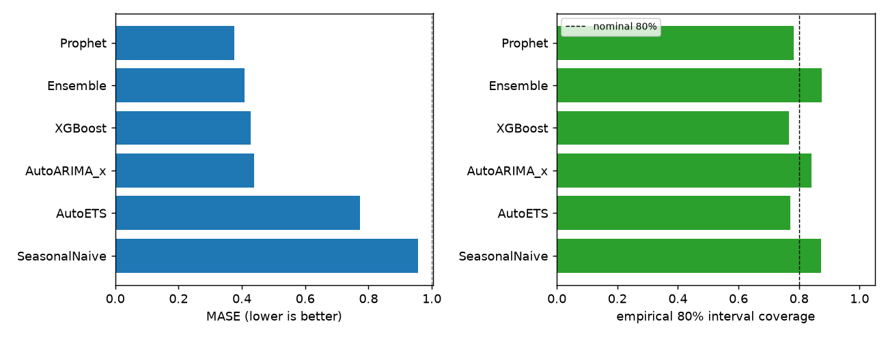
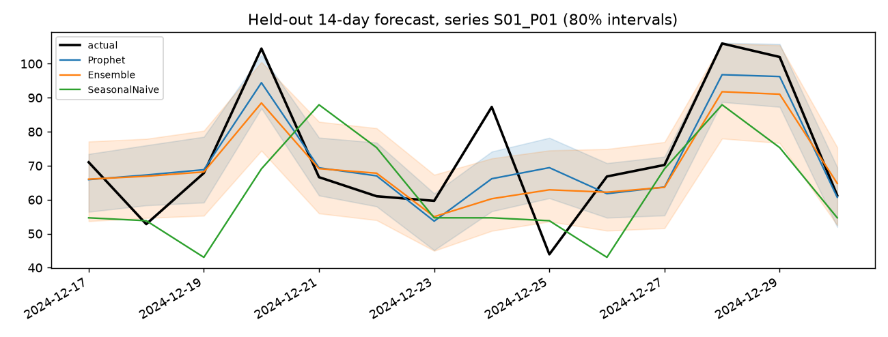
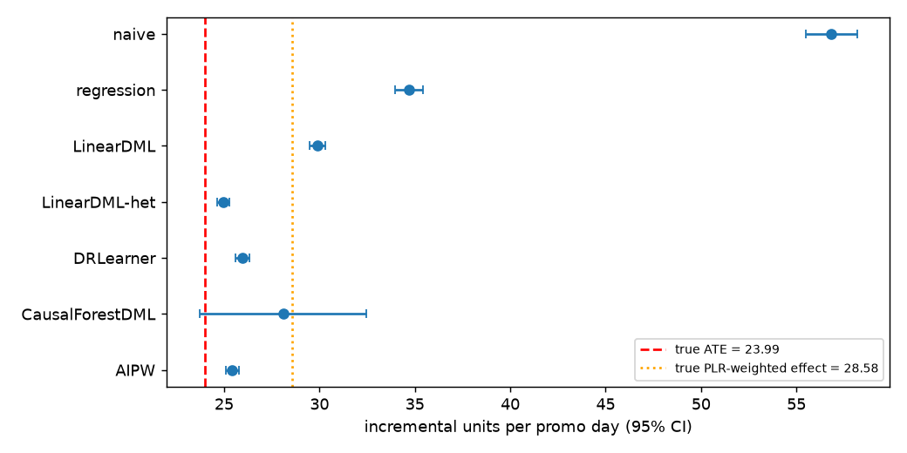
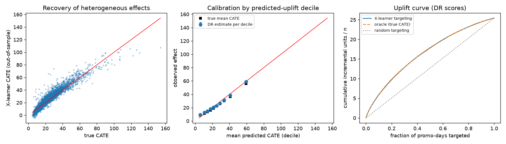

# Demand forecasting and causal uplift report

Synthetic data, seed 42: 8 stores x 5 products x 1095 days = 43,800 rows; promo rate 21.1%.

## Forecast backtest

Rolling origin: 4 origins, step 28 days, horizon 14 days, 6 series. MASE scaled by in-sample seasonal-naive (m=7) MAE; interval nominal level 80%.

| model | MASE | sMAPE (%) | 80% coverage | mean width |
|---|---|---|---|---|
| Prophet | 0.377 | 9.493 | 0.783 | 23.612 |
| Ensemble | 0.409 | 10.026 | 0.875 | 32.812 |
| XGBoost | 0.428 | 10.765 | 0.768 | 27.196 |
| AutoARIMA_x | 0.438 | 11.067 | 0.842 | 32.199 |
| AutoETS | 0.774 | 19.393 | 0.771 | 48.240 |
| SeasonalNaive | 0.956 | 23.550 | 0.872 | 82.786 |

## Causal uplift

Ground truth: ATE = **23.989** incremental units per promo day (ATT = 31.607; Var(D|X)-weighted partially-linear estimand = 28.585).

| method | estimate | se | ci_low | ci_high | bias | covers_ate |
|---|---|---|---|---|---|---|
| naive | 56.829 | 0.690 | 55.478 | 58.181 | 32.840 | no |
| regression | 34.692 | 0.380 | 33.947 | 35.437 | 10.703 | no |
| LinearDML | 29.889 | 0.217 | 29.465 | 30.314 | 5.900 | no |
| LinearDML-het | 24.951 | 0.168 | 24.622 | 25.281 | 0.962 | no |
| DRLearner | 25.954 | 0.184 | 25.594 | 26.314 | 1.965 | no |
| CausalForestDML | 28.091 | 2.237 | 23.708 | 32.475 | 4.102 | yes |
| AIPW | 25.424 | 0.171 | 25.088 | 25.759 | 1.434 | no |

### CATE learners (out-of-sample, 2-fold cross-fitting)

| learner | corr_true | rmse | calib_slope | calib_slope_se | uplift_auc_gain |
|---|---|---|---|---|---|
| T-learner | 0.898 | 8.421 | 0.827 | 0.015 | 0.140 |
| X-learner | 0.949 | 5.252 | 0.934 | 0.014 | 0.147 |
| CausalForestDML | 0.806 | 10.353 | 1.236 | 0.023 | 0.130 |

Best learner by correlation with true CATE: **X-learner**. `calib_slope` is the regression slope of doubly-robust scores on predicted CATE (1 = calibrated); `uplift_auc_gain` is the mean gap between the targeting curve and random targeting, as a multiple of the ATE.

| decile | pred | dr | dr_se | true | n |
|---|---|---|---|---|---|
| 1 | 5.646 | 9.445 | 0.293 | 8.667 | 4380 |
| 2 | 10.465 | 12.707 | 0.367 | 11.351 | 4380 |
| 3 | 14.135 | 15.070 | 0.443 | 13.788 | 4380 |
| 4 | 17.804 | 18.044 | 0.445 | 16.345 | 4380 |
| 5 | 21.345 | 20.609 | 0.474 | 19.220 | 4380 |
| 6 | 25.006 | 22.881 | 0.500 | 22.326 | 4380 |
| 7 | 28.909 | 26.577 | 0.444 | 25.693 | 4380 |
| 8 | 33.619 | 31.436 | 0.491 | 30.102 | 4380 |
| 9 | 40.875 | 38.409 | 0.588 | 36.602 | 4380 |
| 10 | 59.290 | 59.058 | 0.786 | 55.796 | 4380 |

### DoWhy identification and refutation

Graph: 10 nodes; every observed covariate (log_price, product, t, sin1, cos1, dow, holiday, store) is a common cause of promo and demand. On a 6,000-row subsample the identified backdoor estimand gives 35.480 (propensity-score stratification) and 31.137 (EconML LinearDML via DoWhy).

| refuter | new_effect | p_value | error |
|---|---|---|---|
| placebo_treatment | 0.087 | 0.466 |  |
| random_common_cause | 35.480 | 0.159 |  |
| data_subset | 35.104 | 0.310 |  |
